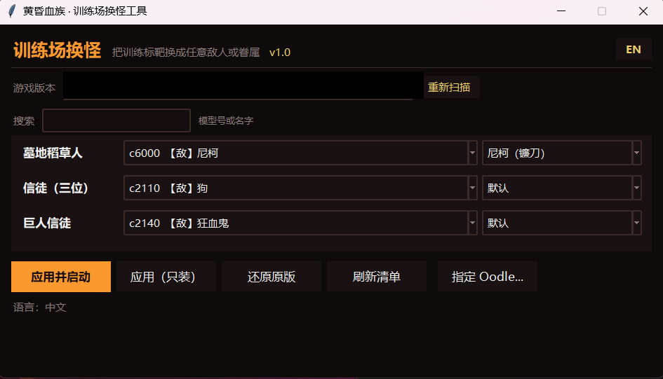
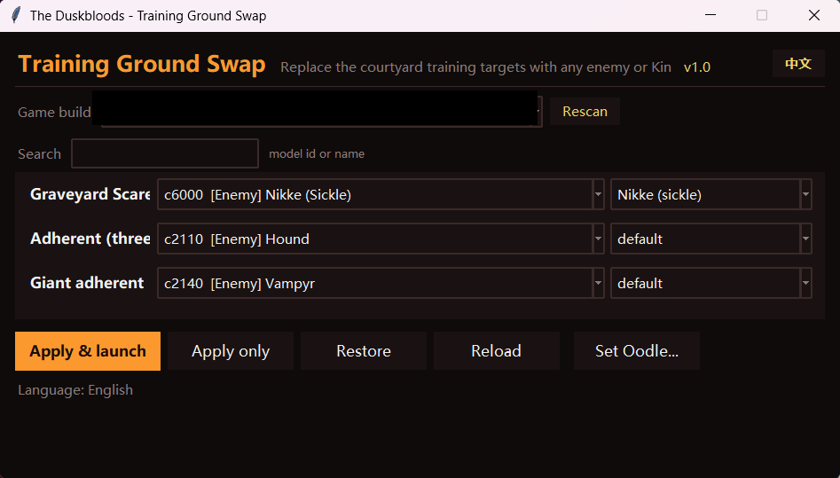

# 训练场换怪 · Training Ground Swap

> 《The Duskbloods 网络测试版》的**庭院训练靶换怪工具**。
> 把「旅程 / 庭院回忆」里的三个训练靶（墓地稻草人、信徒、巨人信徒）换成任意敌人、Boss 或眷属。

<p align="center">
  <b>1.0</b> · Windows · Python 3.10+ · 中英双语界面
</p>

<p align="center">
  
  
  <br>
  <sub>中文界面 / English UI —— 右上角一键切换</sub>
</p>

---

## 这个工具做什么

《The Duskbloods》的训练场里有三个固定标靶。这个工具改的是
`map/mapstudio/m80_00_00_00.msb.dcx`（夜之家 / 庭院那张图），做法是标准 **LayeredFS**：

- 把对应角色池的**模型名**就地改成目标角色的模型（`c2140` = Vampyr、`c6000` = Nikke…）
- 把该池每个部件的 **think（AI）+ npc + CharaInit** 换成目标角色的值
- 打包回 DCX 放进游戏的 mod 目录（LayeredFS），启动时自动叠上去
- **同时**改菜单文本（`msg/*/menu_nt.msgbnd.dcx`）里的靶子名字，所以菜单里显示的是「Vampyr」而不是「Adherent」

改完进游戏：`标题按 A → 大厅 Plus → 庭院 → A`，在标靶面板里切。

---

## 下载与安装

1. 到 [Releases](../../releases) 下载最新的 `training-swap-tool-1.0-installer.zip`
2. 解压，双击里面的 **`一键安装.exe`**
3. 按提示走完（会自动找 Python、装好文件、建桌面快捷方式）

安装器把工具装到 `%LOCALAPPDATA%\DuskTrainingTool`；
就是一个目录、一个快捷方式。

> 想只用不装？`src\training_tool.py` 直接 `python src\training_tool.py` 也能跑（把 `src\tools` 保持在旁边）。

---

## 前置条件

| 需要 | 说明 |
|---|---|
| Windows 10/11 | 只在 Windows 上测过 |
| Python 3.10+ | 需要带 tkinter。安装器会自动找；没装会提示去 python.org 装 3.12 |
| 游戏本体 | 已解包的 `base\exefs\main` + `base\romfs`（**不含游戏文件**，需自备） |
| `oo2core_9_win64.dll` | **改怪（重新压 MSB）需要它**。三种给法见下面「Oodle 库怎么给它」。因版权原因**本仓库不分发这个 DLL** |

---

## Oodle 库怎么给它

改怪要重新把 MSB 压回 DCX（Kraken），这需要 `oo2core_9_win64.dll`。
它在**你自己的**《艾尔登法环》或《黑夜君临》游戏目录里（找 `oo2core_9_win64.dll`）。
本仓库不分发它。按优先级，工具会这样找：

1. 环境变量 `DUSK_OO2CORE`（给文件路径或所在目录都行）
2. 你点 **`指定 Oodle...`** 选过、并记住的路径（存在 `tools\oo2core.path`）
3. 工具目录、上一级、上两级里的 `oo2core_9_win64.dll`

都找不到时，点「应用」会直接弹窗问你要不要现在指定，指定完自动重试一次。

## 使用

1. 三个标靶各选一个角色（可直接搜模型号/名字；「变体」下拉里能选同一角色的不同形态）
2. 点 **应用并启动**
3. 进游戏：`标题按 A → 大厅 Plus → 庭院 → A`，在面板里切标靶
4. 想还原：点工具里的 **还原原版**

右上角 `EN / 中文` 切换语言。英文名用的是游戏内官方叫法
（`Graveyard Scarecrow` / `Adherent` / `Giant adherent` / `Kin` / `Bloodsworn`）。

---

## 常见问题

**「应用」失败，报找不到 `oo2core_9_win64.dll`**
点工具右下角的 **`指定 Oodle...`** 按钮，选中那个 DLL 即可（会记住）。
也可以把它复制到工具目录，或设环境变量 `DUSK_OO2CORE` 指向它（文件或目录都行）。
只换文本/名字不需要它，只有**重新打包 MSB** 才需要。

**提示「需要 Python」**
到 python.org 装 Python 3.12，安装时勾选 **tcl/tk**；装完再运行一次「一键安装.exe」。

**SmartScreen 拦住了 / 杀软报毒**
exe 没有代码签名，属正常现象：点「更多信息 → 仍要运行」。也可以直接从源码跑，不用 exe。

**游戏里没变化**
确认是**进了庭院**（不是大厅），并且是按 `Plus → 庭院 → A` 打开的那个标靶面板；
换怪需要重启游戏生效（约 90 秒）。

---

## 已知限制

- 只改 `m80`（夜之家 / 庭院）这张图；训练场以外的地图不受影响。
- 换怪要**重启游戏**，不能游戏内热切换。
- 三个标靶的位置/数量是游戏里固定的：信徒那个靶一次刷 3 个，选单体角色时工具会把多余的隐藏。
- 只在 Windows 上验证过。

---

## 目录结构

```
src/                       工具源码（可直接运行）
  training_tool.py         主程序（Tk 界面）
  catalog.json             模型清单（27 个模型 + 变体 + 官方英文名）
  tools/
    detect.py              定位 mod（load）目录
    paths.py               路径与配置
    training_build.py      构建 & 安装 MSB
    msb_inspect.py         MSB 结构解析
    patch_m80.py           DCX 解码/编码（Kraken，靠 oo2core）
build/                     重新打包一键安装器用的脚本
release/                   发布用 zip（也是 GitHub Release 的附件）
```

重新打包安装器：

```powershell
python build\make_installer_v1only.py
```

（它直接从本仓库的 `src\` 取文件，产物进 `release\`。）

---

## 免责声明

- 本工具**不含**任何游戏本体、密钥或存档；你需要自己合法拥有《The Duskbloods 网络测试版》。
- 只做本地文件修改（游戏的 mod 目录），不联网、不修改线上数据。
- 与 FromSoftware、Nintendo、任何模拟器项目**没有关联**。
- 游戏素材、角色名及 `oo2core_9_win64.dll` 的权利归各自所有者；本仓库不附带这些内容。
- 使用本工具造成的任何后果（存档、封禁、损坏）由使用者自行承担。

## 许可

本仓库自有代码按 [MIT](LICENSE) 发布。
`catalog.json` 里出现的角色名等游戏内容，权利归原厂所有，仅作兼容性标识用途。